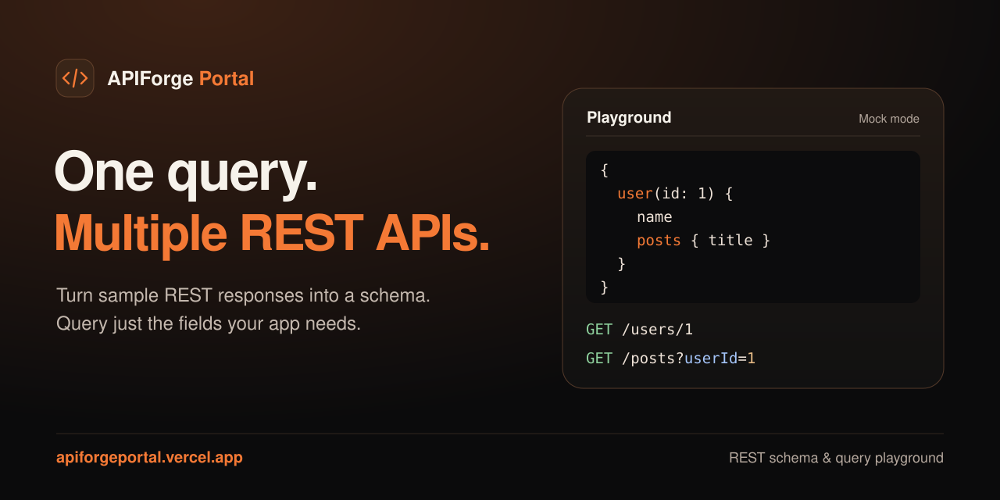
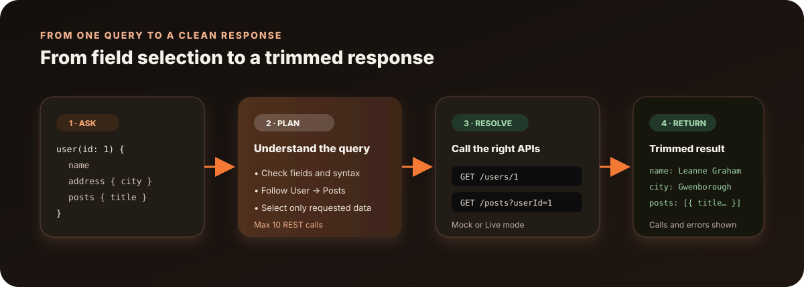
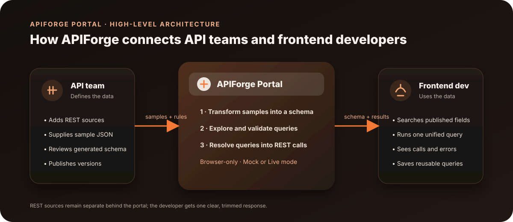

# APIForge Portal

Generate a GraphQL-style schema from sample REST responses, then query only the fields your app needs.

[Quick start](#quick-start) · [Example query](#example-query) · [How it works](#how-it-works) · [Project structure](#project-structure)

## Quick start

Open the [live demo](https://apiforgeportal.vercel.app/) and choose **Frontend developer → Playground → Run query**. The bundled sample starts in Mock mode.

To run the same website locally, use Python 3 from the repository folder:

~~~bash
git clone https://github.com/ROSHINI-CLOUD/APIForgeportal.git
cd APIForgeportal
python3 -m http.server 5500 --bind 127.0.0.1
~~~

Open [localhost:5500](http://localhost:5500). HTML, CSS, and vanilla JavaScript run directly in the browser.

## Example query

Fetch a user's name, city, and post titles:

~~~graphql
{
  user(id: 1) {
    name
    address { city }
    posts { title }
  }
}
~~~

The REST calls panel shows:

~~~text
GET /users/1
GET /posts?userId=1
~~~

The response includes Leanne Graham, Gwenborough, and three post titles. The seeded relationship between users and posts turns the nested selection into the second REST lookup.

## How it works

| Demo role | Workflow |
| --- | --- |
| **API team** | Register REST sources and sample JSON, generate a draft schema, rename or hide fields, then publish a version with a change list. |
| **Frontend developer** | Search the published schema, open a starter query from Explorer, run it in Playground, and save useful queries. |

The Playground shows formatted JSON beside the query and lists the REST calls underneath, with their paths, modes, and field counts. It keeps the last 20 query runs.

## Mock mode and Live mode

- **Mock** uses bundled JSON samples. It runs without internet access when the site is served locally.
- **Live** sends GET requests to browser-accessible endpoints. The seeded source uses JSONPlaceholder, and failed requests can return labeled mock fallback results.

This browser-only demo supports nested selections, an optional query name, and one literal ID argument per endpoint selection. Queries are limited to 10 REST calls. The role picker and project data use browser storage. **Reset demo data** restores the seed data and clears local changes. The copy action provides a request template for a separately deployed GraphQL gateway.

## Project structure

| File or folder | What it does |
| --- | --- |
| [index.html](index.html), [index.css](index.css) | Landing page, role picker, and shared styles |
| [sources.html](sources.html), [endpoint.html](endpoint.html) | Edit sources, GET endpoints, and sample JSON |
| [schema.html](schema.html), [versions.html](versions.html) | Review, publish, and compare schema versions |
| [explorer.html](explorer.html), [playground.html](playground.html), [saved.html](saved.html) | Browse fields, run queries, and revisit saved queries and history |
| [js/app.js](js/app.js), [js/session.js](js/session.js), [js/storage.js](js/storage.js) | Page events, demo roles, and browser persistence |
| [js/transform.js](js/transform.js) | Infers schema types from JSON and creates the schema preview |
| [js/parser.js](js/parser.js), [js/resolver.js](js/resolver.js) | Reads query syntax, resolves REST calls, and returns selected fields |
| [data/](data/) | JSON source definitions and mock responses |

For a code walkthrough, start with the sample query and follow it from the parser, through the resolver, to the response and call list in Playground.

## Project docs

- [Mini product requirements](docs/APIForge-Portal-Mini-PRD.md)
- [Full product requirements](docs/APIForge-Portal-PRD.md)
