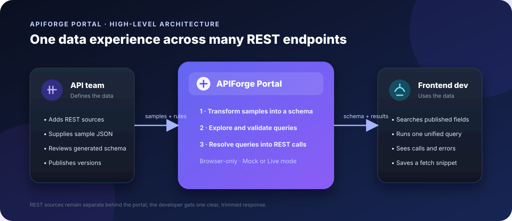
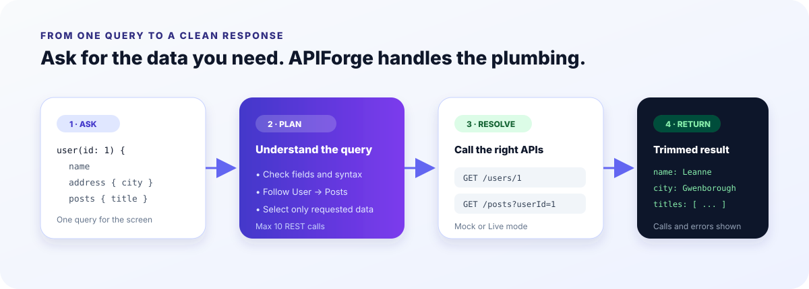

<div align="center">

# APIForge Portal

### REST-to-GraphQL schema transformer and unified proxy playground

Turn several REST endpoints into one discoverable, developer-friendly data experience.

<p>
  <a href="https://github.com/ROSHINI-CLOUD/APIForgeportal"><strong>Repository</strong></a>
  ·
  <a href="#quick-start"><strong>Quick start</strong></a>
  ·
  <a href="#how-it-works"><strong>How it works</strong></a>
</p>



</div>


## What is APIForge?

APIForge Portal is a laptop-first, responsive web app for frontend developers and API teams.
It reads sample JSON responses from REST endpoints, generates a clear GraphQL-style schema,
and lets developers run one query across multiple REST APIs.

Instead of manually calling several endpoints and filtering large responses, a developer can ask
for exactly what a screen needs—such as a user's name, city, and post titles. APIForge plans the
required REST calls, combines the results, and returns a small, query-shaped response.

> **Project scope:** a focused four-week, first-year OJT MVP. The gateway runs in the browser;
> there is intentionally no backend server, authentication system, or full GraphQL implementation.

## Why it exists

| Without APIForge | With APIForge |
| --- | --- |
| Read several REST API documents | Browse one published data catalogue |
| Make multiple calls for one screen | Write one unified query |
| Receive more data than needed | Receive only requested fields |
| Manually connect related responses | Follow configured relationships |
| Discover breaking changes late | Review schema changes before publishing |

## How it works

1. **Register a source** — An API team member adds a base URL, endpoints, and sample JSON.
2. **Generate the schema** — APIForge infers objects, fields, lists, and scalar types.
3. **Review and publish** — The API team can rename or hide fields, then publish versioned schemas.
4. **Explore** — Frontend developers search the published schema and see where fields come from.
5. **Run one query** — The playground translates the query into the REST calls it needs.
6. **Reuse the result** — Developers inspect the calls, save the query, and copy a fetch snippet.



## Example

The developer wants a profile card containing a user's name, city, and post titles:

```graphql
{
  user(id: 1) {
    name
    address { city }
    posts { title }
  }
}
```

In Mock mode, APIForge resolves this through:

```text
GET /users/1
GET /posts?userId=1
```

The response contains only the requested fields, while the Calls panel explains what happened.

## Main capabilities

- Demo role picker for **API team** and **Frontend developer**.
- Source and endpoint registry with JSON validation.
- Automatic REST sample → GraphQL-style schema transformation.
- Inference notes for ambiguous values, `null`, and empty arrays.
- Field/type renaming and hidden-field controls.
- Published schema versions with change lists.
- Searchable schema Explorer with endpoint provenance.
- Query Playground with nested selections and configured relations.
- Trimmed responses, GraphQL-style errors, REST call plans, and call limits.
- Saved queries and the last 20 query runs.
- Mock mode for reliable offline demos and Live mode for JSONPlaceholder.
- Responsive layouts for laptop, tablet, and 375px phone widths.

## Roles and permissions

| Role | Can do | Cannot do |
| --- | --- | --- |
| **API team** | Manage sources, endpoints, schemas, relations, and published versions | — |
| **Frontend developer** | Browse published schemas, run queries, save queries, view history | Edit sources, edit schemas, manage relations, or publish |

The login is a demo role switcher, not a real account system.

## Technology stack

| Layer | Choice | Purpose |
| --- | --- | --- |
| UI | HTML5, CSS3, Bootstrap 5.3 | Responsive screens, forms, cards, tabs, tables, and modals |
| Logic | Vanilla JavaScript | DOM events, validation, parsing, transformation, and resolution |
| Persistence | Browser `localStorage` | Sources, drafts, schema versions, saved queries, and history |
| Seed data | JSON files | Offline users, posts, and comments |
| Live API | JSONPlaceholder | Public CORS-enabled REST testing |
| Tooling | VS Code, Live Server, Git, GitHub | Local development and collaboration |
| Hosting | GitHub Pages or Vercel | Static deployment |

The MVP deliberately avoids a framework and backend so the core data transformation and resolver
logic remain easy to inspect and test.

## Suggested project structure

```text
apiforge-portal/
├── index.html
├── sources.html
├── endpoint.html
├── schema.html
├── versions.html
├── explorer.html
├── playground.html
├── saved.html
├── relations.html
├── css/
│   └── styles.css
├── js/
│   ├── storage.js       # localStorage and seeded data
│   ├── session.js       # demo role/session state
│   ├── transform.js     # sample JSON → schema
│   ├── sdl.js           # schema text generation
│   ├── diff.js          # schema version comparison
│   ├── parser.js        # supported query subset
│   ├── resolver.js      # query → REST calls → response
│   ├── components.js    # reusable UI components
│   └── pages/           # page-specific behaviour
└── data/
    ├── sources.json
    └── mocks/
        ├── users.json
        ├── posts.json
        └── comments.json
```

## Quick start

The project is a static web app and does not need a build server or database.

```bash
git clone https://github.com/ROSHINI-CLOUD/APIForgeportal.git
cd APIForgeportal
```

Open the folder with VS Code and start it with **Live Server**, or serve it with any static file
server. Then open the local URL in a browser and choose a demo role.

For a simple Python static server:

```bash
python3 -m http.server 5500
```

Open <http://localhost:5500>.

## Mock and Live modes

### Mock mode

Mock mode reads bundled JSON files. It is the default for demos because it works offline and gives
repeatable results.

### Live mode

Live mode calls the public JSONPlaceholder API. Only public, browser-accessible GET endpoints are
within the MVP scope. Network or CORS failures should guide the user back to Mock mode.

## Supported query scope

The playground supports a deliberately small, teachable query language:

- Optional query name.
- Top-level fields mapped to GET endpoints.
- One literal argument, such as `id: 1`.
- Nested selections, including configured relations.
- Clear errors for invalid syntax, unknown fields, and unsupported features.
- A maximum of 10 REST calls per query.

The MVP does not support mutations, subscriptions, fragments, directives, variables, aliases, or
the complete GraphQL specification.

## Data and browser storage

The app seeds its first run from `data/sources.json` and `data/mocks/*.json`. After that, the browser
stores changes in `localStorage`. The **Reset demo data** action returns the app to its seeded state.

Because there is no backend, data is local to the current browser and is not synchronized between
devices or users.

## Four-week delivery plan

| Week | Focus | Milestone |
| --- | --- | --- |
| 1 | HTML, Bootstrap, JSON, REST/GraphQL basics | Static responsive screens |
| 2 | Validation, recursion, transformation, localStorage | Schema generation and Explorer |
| 3 | Parser, resolver, fetch, errors, relations | Working unified Playground |
| 4 | Accessibility, testing, polish, deployment | Deployed demo, README, and demo video |

## Acceptance highlights

- Invalid JSON is rejected with a line number.
- The worked user sample produces the expected schema.
- `null` and empty arrays are visibly flagged for review.
- Schema renames update all references and appear in the publish change list.
- The worked query returns the expected user, city, and post titles with two REST calls.
- Unknown fields, syntax errors, and unsupported features never crash the page.
- Saved queries and history survive a refresh.
- Role restrictions work even when a user tries to open a restricted page directly.
- Every screen remains usable at 375px width.

## Repository

- **GitHub:** [ROSHINI-CLOUD/APIForgeportal](https://github.com/ROSHINI-CLOUD/APIForgeportal)
- **Upstream URL:** `https://github.com/ROSHINI-CLOUD/APIForgeportal.git`

## Contributing

1. Create a focused branch for your change.
2. Keep transformation and resolver logic free of DOM code so it can be tested independently.
3. Test Mock mode first, then verify Live mode where applicable.
4. Check both desktop and 375px layouts.
5. Use clear commits and update this README when behaviour or scope changes.

## Project status

**Ready for kickoff · PRD v1.0 · PST_PD_175 · 4-week OJT MVP**
