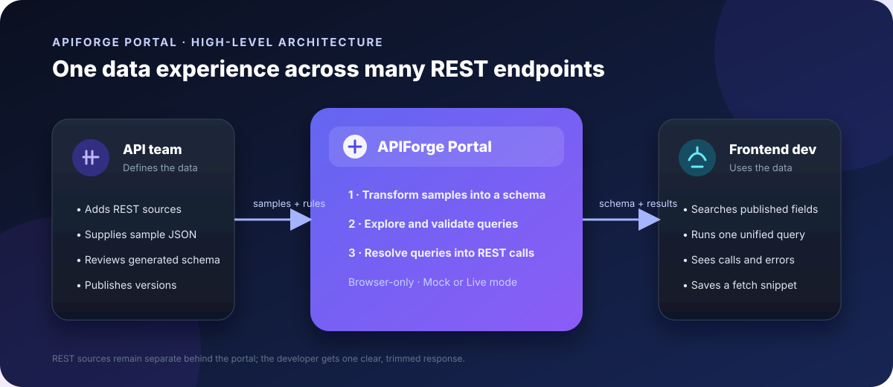
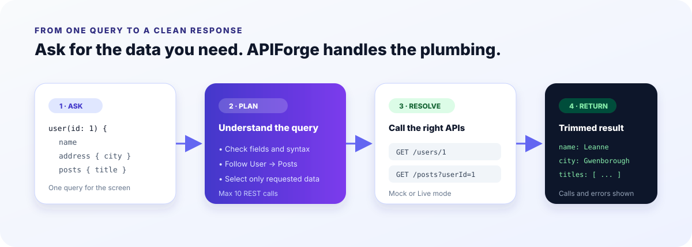

# APIForge Portal — Product Requirements Document

> REST-to-GraphQL schema transformer and unified proxy portal

| Field | Value |
| --- | --- |
| Product ID | `PST_PD_175` |
| Track | 2026 Level 1 — Core |
| Duration | 4 weeks |
| Team | 2 students |
| Version | `v1.0` |
| Status | Ready for kickoff |
| Platform | Responsive web app, laptop-first |
| Backend | None for the MVP |



## 1. Product overview

APIForge Portal helps frontend developers use several REST APIs as if they were one unified data
source. An API team member registers REST sources, adds endpoint details, and provides one sample
JSON response per endpoint. The portal reads those samples and creates a GraphQL-style schema that
the API team can review, rename, hide, and publish.

Frontend developers browse the published schema and write a query in the Playground. The browser
translates the query into the REST calls it needs, follows configured relationships, returns only the
requested fields, and displays the REST calls made.

### Product promise

> A frontend developer can fetch a user, their city, and the titles of their posts with one query,
> without reading two REST documents, in under 30 seconds.

### MVP boundary

The MVP is a client-side demonstration. Sources, schemas, and saved queries are stored in the
browser using `localStorage`. Live calls are limited to public, browser-accessible test APIs such as
JSONPlaceholder. Every source also supports Mock mode using bundled JSON files.

The MVP does not include a server-side gateway, mutations, subscriptions, API keys, authentication,
or a full GraphQL implementation.

## 2. Problem statement

Frontend developers often build one screen from several REST endpoints owned by different teams.
They read separate documents, make several calls, receive large responses, and manually connect or
filter the data they need.

When an API changes, the developer may not know until the screen breaks. API teams also repeatedly
answer questions about what an endpoint returns because their documents do not always match the
current responses.

### Example problem

Sneha is building a user profile card that needs a user's name, city, and latest post titles. She
must currently:

1. Read the Users API documentation.
2. Read the Posts API documentation.
3. Make two REST calls.
4. Find the city inside the nested `address` object.
5. Filter posts by user ID.
6. Remove the many fields the card does not use.

APIForge gives her one visible data shape and one query for the screen.

## 3. Goals and non-goals

### Goals

- Make REST data shapes easy to browse and understand.
- Generate a useful schema from sample JSON.
- Combine related REST endpoints through one query.
- Return only requested fields.
- Show the REST calls made behind each query.
- Make schema changes visible before publication.
- Provide a dependable offline Mock mode.
- Demonstrate clear role-based screens and responsive layouts.

### Non-goals

- Building a production API gateway.
- Supporting every GraphQL language feature.
- Managing real user accounts or permissions on a server.
- Importing complete OpenAPI or Swagger documents.
- Supporting write operations against REST APIs.
- Synchronizing data between browsers or devices.

## 4. Personas

| Persona | Context | Goal | Frustrations | Success measure |
| --- | --- | --- | --- | --- |
| **Sneha Pillai** — Frontend developer | Builds SaaS dashboards, knows REST, has limited GraphQL experience | Get exactly the data a screen needs with one request | Outdated docs, over-fetching, multiple calls, surprise changes | Copies a working query and fetch snippet into her app in minutes |
| **Farhan Ali** — API team lead | Leads a team owning Users and Posts services | Describe APIs once and keep the description current | Documentation drift and repeated “what does this return?” questions | Publishes version 2 and reviews the changes before release |

## 5. User journeys

### Journey A — Generate and publish a schema

1. Farhan selects the **API team** role.
2. He opens the seeded `JSONPlaceholder (Users & Posts)` source.
3. He adds `GET /users/{id}`, names the resource `user`, and loads or pastes sample JSON.
4. APIForge validates the JSON and reports the line when it is invalid.
5. The Schema screen shows the sample beside the generated schema and inference notes.
6. Farhan renames `Geo` to `GeoPoint`.
7. He publishes version 2.
8. The publish dialog lists changes such as `Geo → GeoPoint` and a new query field.

### Journey B — Explore the published schema

1. Sneha selects the **Frontend developer** role.
2. The Explorer opens on the latest published version.
3. She searches for `city`.
4. APIForge shows `Address.city: String!` and the path `user → address → city`.
5. She selects **Try in playground**.
6. The Playground opens with a starter query for that path.

### Journey C — Run a unified query

1. Sneha writes:

   ```graphql
   {
     user(id: 1) {
       name
       address { city }
       posts { title }
     }
   }
   ```

2. She runs the query in Mock mode.
3. APIForge calls `GET /users/1` and `GET /posts?userId=1`.
4. The response contains the requested name, city, and post titles.
5. The Calls panel shows the two REST calls and their timing.
6. A wrong field such as `phone2` produces a clear query error.
7. Sneha saves the query as `Profile card` and copies a fetch snippet.



## 6. Scope

### Must have — MVP

1. Demo login with **API team** and **Frontend developer** roles.
2. Source registry for adding, editing, and deleting REST sources.
3. Endpoint editor with method, path, resource name, and sample JSON.
4. Mock and Live source modes.
5. JSON validation with line-level errors.
6. Automatic schema transformation from sample responses.
7. Inference of object types, scalar types, lists, required fields, and query fields.
8. Schema notes explaining uncertain inferences.
9. Type and field renaming.
10. Hidden-field controls.
11. Published schema versions with change lists.
12. Schema Explorer with field search and endpoint source information.
13. Query Playground for the supported query subset.
14. REST call planning, relation resolution, field trimming, and GraphQL-style errors.
15. Seeded `User.posts` relation.
16. Saved queries, rename/delete controls, and the last 20 runs in history.
17. Fetch snippet copying.
18. Role restrictions for management and publishing features.
19. `localStorage` persistence with Reset demo data.
20. Responsive Bootstrap 5 layout for laptop and 375px phone widths.

### Good to have

- CSV export of schema fields.
- Print-friendly schema page.
- Source mode and status filters.
- Field type filters.
- History success/error filters.
- Relation editor for the API team.
- Downloadable `schema.graphql` file.

### Stretch work

- Chart of REST bytes received versus bytes returned.
- Queries-per-day chart.
- React and Vite rebuild of the Playground.
- Query variables and aliases.
- Small Node/Express server that runs the same resolver.

### Out of scope

- Mutations and subscriptions.
- Fragments and directives.
- A full GraphQL parser.
- A server-side proxy or gateway.
- Authentication headers, API keys, and rate limiting.
- Complete OpenAPI/Swagger import.
- Real user accounts and cross-device synchronization.

## 7. User stories

| ID | Role | Need | Reason | Priority |
| --- | --- | --- | --- | --- |
| US-01 | API team | Register a REST source and endpoints | The portal knows where data comes from | Must |
| US-02 | API team | Generate a schema from samples | Types do not need to be written by hand | Must |
| US-03 | API team | Rename types/fields and hide fields | The shared schema is clean and safe | Must |
| US-04 | API team | Publish versions and see changes | Consumers are not surprised | Must |
| US-05 | Frontend developer | Browse and search the schema | Data shape is clear before coding | Must |
| US-06 | Frontend developer | Combine two REST endpoints in one query | One screen needs one data request | Must |
| US-07 | Frontend developer | Receive only requested fields | The app handles less data | Must |
| US-08 | Frontend developer | See clear syntax and field errors | Queries can be fixed quickly | Must |
| US-09 | Frontend developer | See the REST calls made | The result is understandable | Must |
| US-10 | Frontend developer | Save queries and copy a fetch snippet | Working requests can be reused | Must |
| US-11 | API team | Export schema fields as CSV | The schema can be shared in review | Good |
| US-12 | Frontend developer | See bytes saved in a chart | The benefit can be demonstrated | Stretch |

## 8. Screen inventory

| ID | Screen | User | Main elements |
| --- | --- | --- | --- |
| S1 | Demo Login | All | Role cards and Reset demo data |
| S2 | Sources | API team | Source cards, base URL, mode, endpoint count, status, Add source |
| S3 | Source / Endpoint Editor | API team | Source form, endpoint table, JSON editor, Validate, Load sample |
| S4 | Schema Transformer | API team | Sample JSON, generated schema text, inference notes, rename/hide, Publish |
| S5 | Versions | API team | Version list, dates, and per-version change lists |
| S6 | Explorer | Both roles | Type list, field table, search, source endpoint, Try in playground |
| S7 | Playground | Both roles | Query editor, Run, mode indicator, response, calls, errors, Save, Copy |
| S8 | Saved Queries & History | Frontend developer | Saved list, rename/delete, history table, status |
| S9 | Relations | API team | Relation table and Add relation form |

## 9. Functional requirements

### 9.1 Source registry

Each source contains:

- A unique ID.
- A display name.
- A base URL beginning with `https://`.
- A mode: `mock` or `live`.
- One or more GET endpoints.

Each endpoint contains:

- HTTP method; the MVP supports GET.
- Path, optionally containing `{id}`.
- Resource name.
- One sample JSON response.
- Whether it returns one object or a list.
- Mock data path where applicable.

### 9.2 Schema transformation

The transformer reads sample JSON and creates:

- Object types.
- Scalar fields.
- Nested objects.
- Lists.
- Required markers.
- Top-level Query fields.
- Inference notes for uncertain values.

The transformer and resolver must remain in modules without DOM code so they can be tested in the
console independently from the user interface.

### 9.3 Schema editing and versions

The API team can rename types and fields or hide fields. Publishing creates versions `v1`, `v2`,
and so on. Each new version compares itself with the previous version and records:

- Added types or fields.
- Removed types or fields.
- Renamed types or fields.
- Changed field types.

Frontend developers see only the latest published version and cannot edit or publish it.

### 9.4 Explorer

The Explorer displays types and fields with:

- Field name.
- GraphQL-style type.
- Source endpoint.
- Search by field name.
- Full field path.
- A link to try the field in the Playground.

### 9.5 Playground and resolver

The Playground must:

- Parse the supported query subset.
- Validate field names and selections.
- Resolve top-level fields to endpoints.
- Follow configured relations to make additional calls.
- Return only requested fields.
- Display GraphQL-style errors.
- Display the method, URL, status, and timing for each REST call.
- Stop with a clear error after more than 10 REST calls.

### 9.6 Saved queries and history

Saved queries contain an ID, name, query text, and update time. Users can open, rename, and delete
them. History stores the last 20 runs with time, query, success state, REST calls, and duration.

## 10. Component breakdown

| Component | Responsibility | Used on |
| --- | --- | --- |
| `Navbar` | Role-aware navigation and reset action | All screens |
| `SourceCard` | Display and open a source | Sources |
| `EndpointForm` | Save and validate endpoint details | Endpoint editor |
| `JsonEditor` | Edit or display JSON with errors | Editor, Schema, Playground |
| `SdlView` | Display schema text and rename/hide controls | Schema, Explorer |
| `ChangeList` | Compare old and new schema versions | Schema, Versions |
| `TypeList` / `FieldTable` | Browse types and fields | Explorer |
| `QueryEditor` | Edit and run a query | Playground |
| `ResponsePanel` | Display data and errors | Playground |
| `CallsPanel` | Display REST calls | Playground |
| `Toast` | Show short-lived status messages | All screens |

## 11. State and data model

### `localStorage` keys

| Key | Shape | Purpose |
| --- | --- | --- |
| `af_session` | `{ role, userId }` | Demo role and session |
| `af_sources` | `Source[]` | Sources, endpoints, and samples |
| `af_relations` | `Relation[]` | Links such as `User.posts` |
| `af_schema_draft` | `Schema` | Generated schema with edits |
| `af_schema_versions` | `Version[]` | Published schemas and changes |
| `af_saved_queries` | `SavedQuery[]` | Reusable queries per demo user |
| `af_history` | `HistoryEntry[]` | Last 20 runs |
| `af_seed_version` | string | Seed-data version marker |

### Seed source

```json
{
  "id": "src_jph",
  "name": "JSONPlaceholder (Users & Posts)",
  "baseUrl": "https://jsonplaceholder.typicode.com",
  "mode": "mock",
  "endpoints": [
    {
      "method": "GET",
      "path": "/users",
      "resource": "users",
      "returns": "list",
      "mock": "data/mocks/users.json"
    },
    {
      "method": "GET",
      "path": "/users/{id}",
      "resource": "user",
      "returns": "one",
      "mock": "data/mocks/users.json"
    }
  ]
}
```

### Seed relation

```json
{
  "parentType": "User",
  "field": "posts",
  "type": "Post",
  "returns": "list",
  "endpoint": "GET /posts?userId={id}"
}
```

### Derived state

The app calculates these values rather than storing separate copies:

- Schema text.
- Change lists between versions.
- Searchable field paths.
- REST call plan for a query.
- Trimmed response.
- Fields returned versus fields available.

## 12. Supported query subset

| Feature | Supported example | Notes |
| --- | --- | --- |
| Optional query name | `query Profile { ... }` | Name is optional |
| Top-level endpoint field | `users { name }` | Maps to a REST endpoint |
| One literal argument | `user(id: 1)` | Literal values only |
| Nested selections | `address { geo { lat } }` | Any supported depth |
| Configured relations | `user(id: 1) { posts { title } }` | Uses relation mappings |
| Mutation | — | Not supported; show an error |
| Subscription | — | Not supported; show an error |
| Fragments | — | Not supported |
| Directives | — | Not supported |
| Variables and aliases | — | Stretch work |

The parser should report line and column information where possible. It must never crash the page
for invalid syntax or an unknown field.

## 13. Schema inference rules

| Sample value or rule | GraphQL-style type | Example |
| --- | --- | --- |
| Key is `id` or ends in `Id` | `ID` | `"id": 1` → `ID!` |
| Whole number | `Int` | `"age": 31` → `Int!` |
| Decimal number | `Float` | `"rating": 4.5` → `Float!` |
| `true` or `false` | `Boolean` | `"completed": false` → `Boolean!` |
| Text | `String` | `"name": "Leanne"` → `String!` |
| `null` | Nullable `String` | Flagged with “Check type” |
| Object | New PascalCase type | `address` → `Address!` |
| Array of objects | List of a singular type | `tags` → `[Tag!]!` |
| Empty array | `[String]` initially | Flagged with “Check type” |
| Present and non-null in every sample item | Required marker `!` | Otherwise nullable |

The inference follows the sample value, not the field's real-world meaning. For example, a value such
as `"lat": "-37.3159"` remains a `String!` because the sample contains text.

### Endpoint-to-Query rules

| REST endpoint | Query field |
| --- | --- |
| `GET /users` returning a list | `users: [User!]!` |
| `GET /users/{id}` returning one object | `user(id: ID!): User` |
| `GET /posts?userId={id}` returning a list | `posts(userId: ID): [Post!]!` |

## 14. Worked schema example

### Sample response

```json
{
  "id": 1,
  "name": "Leanne Graham",
  "email": "Sincere@april.biz",
  "address": {
    "city": "Gwenborough",
    "zipcode": "92998-3874",
    "geo": {
      "lat": "-37.3159",
      "lng": "81.1496"
    }
  },
  "website": "hildegard.org"
}
```

### Generated schema with the seeded `User.posts` relation

```graphql
type User {
  id: ID!
  name: String!
  email: String!
  website: String!
  address: Address!
  posts: [Post!]!
}

type Address {
  city: String!
  zipcode: String!
  geo: Geo!
}

type Geo {
  lat: String!
  lng: String!
}

type Post {
  userId: ID!
  id: ID!
  title: String!
  body: String!
}

type Query {
  users: [User!]!
  user(id: ID!): User
  posts(userId: ID): [Post!]!
}
```

## 15. Worked resolver example

Query:

```graphql
{
  user(id: 1) {
    name
    address { city }
    posts { title }
  }
}
```

Resolver steps:

1. Match `user(id: 1)` to `GET /users/{id}`.
2. Call `GET /users/1`.
3. Pick `name` and `address.city` from the response.
4. Recognize `posts` as a `User.posts` relation.
5. Call `GET /posts?userId=1`.
6. Pick `title` from each returned post.
7. Build the response in the order requested by the query.

Expected shape:

```json
{
  "data": {
    "user": {
      "name": "Leanne Graham",
      "address": { "city": "Gwenborough" },
      "posts": [
        { "title": "..." },
        { "title": "..." },
        { "title": "..." }
      ]
    }
  }
}
```

The Mock example makes two REST calls. The response includes only the requested leaf fields rather
than the full source responses.

## 16. UI states and error behaviour

| Screen | Loading | Empty | Error | Success / partial |
| --- | --- | --- | --- | --- |
| Sources | Skeleton source cards | “No sources yet” | Invalid base URL message | “Source saved” toast |
| Endpoint editor | “Fetching sample…” in Live mode | JSON example placeholder | Invalid JSON with line | “Sample is valid” toast |
| Schema | “Generating schema…” | “Add endpoints with samples” | Rename collision | Publish success with change count |
| Playground | “Calling 2 endpoints…” | Starter query and tips | Syntax, field, 404, or network error | Data, calls, timing, and field count |
| Saved/history | Skeleton rows | “No saved queries yet” | Failed run with message | “Query saved” toast |

Important messages include:

- `Invalid JSON at line 4: Unexpected token }`
- `Couldn’t reach the API (network or CORS). Paste a sample instead.`
- `Cannot query field "phone2" on type "User".`
- `GET /users/99 returned 404`
- `A type named Post already exists`
- `One relation call failed: posts is null`

## 17. Responsive behaviour

| Area | Phone under 576px | Tablet 576–991px | Laptop 992px and above |
| --- | --- | --- | --- |
| Schema | Tabs: Sample / Schema / Notes | Two stacked panels | Sample and schema side by side |
| Playground | Tabs: Query / Response / Calls; fixed Run button | Query above response | Query beside response, calls below |
| Explorer | Type dropdown and field cards | Stacked layout | Type sidebar and field table |
| Tables | Card layout | Compact table | Full table and filters |
| Code editors | Full width, horizontal scroll | Same | Fixed-height scrollable editor |

## 18. Visual design and accessibility

### Design tokens

| Token | Value | Use |
| --- | --- | --- |
| Primary | `#4338CA` | Main actions and branding |
| Text | `#1F2937` | Primary text |
| Secondary text | `#4B5563` | Supporting text |
| Code panel | `#0F172A` | Query and schema panels |
| Code panel surface | `#E2E8F0` | Code panel text and borders |
| Success | `#86EFAC` | Successful result indicators |
| Error | `#FCA5A5` | Code-panel error indicators |
| Error on white | `#B91C1C` | Page-level errors |

### Accessibility requirements

- Use labelled `<textarea>` editors for GraphQL queries and sample JSON.
- Tab inserts two spaces while an editor has focus.
- `Esc` then `Tab` moves focus out of an editor.
- Announce results and errors with `aria-live="polite"`.
- Include line and column in syntax errors.
- Use words and icons, not colour alone, for success and error states.
- Use the Bootstrap tab pattern with `role="tablist"` on phone layouts.
- Support keyboard actions, including `Ctrl+Enter` to run a query.
- Target Lighthouse Accessibility of at least 90 on Schema and Playground screens.

## 19. Technology stack

| Layer | Choice | Reason |
| --- | --- | --- |
| UI | HTML5, CSS3, Bootstrap 5.3 | Semester stack and responsive components |
| Logic | Vanilla JavaScript | DOM events, forms, recursion, parsing, fetch, and async work |
| Storage | `localStorage` | No server required for the demonstration |
| Seed data | JSON files | Reliable offline Mock mode |
| Live service | JSONPlaceholder | Free public REST API with browser access |
| Export | Blob download and browser print | CSV, schema download, and PDF-friendly output |
| Tools | VS Code, Live Server, DevTools, Git/GitHub | Development and review |
| Hosting | GitHub Pages or Vercel | Static deployment |

### Suggested file layout

```text
apiforge-portal/
├── index.html
├── sources.html
├── endpoint.html
├── schema.html
├── versions.html
├── explorer.html
├── playground.html
├── saved.html
├── relations.html
├── css/styles.css
├── js/
│   ├── storage.js
│   ├── session.js
│   ├── transform.js
│   ├── sdl.js
│   ├── diff.js
│   ├── parser.js
│   ├── resolver.js
│   ├── components.js
│   └── pages/
└── data/
    ├── sources.json
    └── mocks/
        ├── users.json
        ├── posts.json
        └── comments.json
```

## 20. Learning goals

By the end of the project, each student should be able to:

1. Build responsive developer-tool layouts with panels and small-screen tabs.
2. Walk nested JSON recursively and generate schema text.
3. Write a small tokenizer and parser for a defined language subset.
4. Use `fetch` and `async/await` with network, CORS, and HTTP error handling.
5. Compare two data-structure versions and list their changes.
6. Enforce role-based views.
7. Explain REST and GraphQL using a working example.

## 21. Four-week milestones

| Week | Learning focus | Build work | Checkpoint |
| --- | --- | --- | --- |
| 1 — Foundations | Git, HTML, Bootstrap, JSON, REST and GraphQL basics | Research conversations, brief, wireframes, static Sources and Playground screens, seed data | Screens work on laptop and phone |
| 2 — Transformer | DOM, events, recursion, schema text, `localStorage` | Source and endpoint forms, JSON validation, transformer, Schema, Explorer | Journey A without publishing and Journey B work |
| 3 — Playground | Tokenizing, parsing, fetch, async work, error handling | Parser, resolver, relations, field trimming, errors, history, versions, role guards | Journeys A and C work |
| 4 — Ship | Accessibility, device testing, deployment | CSV and filters if time, usability testing, README, deployment, demo video | Live URL and checklist pass |

## 22. Evaluation and acceptance criteria

### Acceptance checklist

1. The API team can add an endpoint; invalid JSON is rejected with a line number.
2. The `GET /users/1` sample produces the worked schema with correct fields and markers.
3. `null` and empty arrays receive “Check type” notes.
4. Renaming `Geo` to `GeoPoint` updates all references and publishing creates version 2.
5. The worked Mock query returns the name, city, and three post titles with exactly two REST calls.
6. Unknown fields, syntax errors, and unsupported features return clear errors without crashing.
7. Live mode makes visible calls to JSONPlaceholder; offline use points to Mock mode.
8. Saved queries and history remain after refresh; the fetch snippet runs in a browser console.
9. Frontend developers cannot access source editing, schema editing, relations, or publishing.
10. Every screen works at 375px width.

### Grading areas

| Area | Points | Full-credit expectation |
| --- | ---: | --- |
| Core journeys A–C | 35 | All journeys complete with sample data |
| Roles and data | 15 | Guards, clean data model, reset, and examples work |
| UI states and responsiveness | 15 | Required states and phone/laptop layouts |
| Visual design and accessibility | 10 | Palette, labels, keyboard support, Lighthouse target |
| Code quality and Git | 10 | DOM-free core logic and readable modules |
| Documentation, usability, demo | 15 | README, three usability notes, and clear demonstration |

## 23. Risks and mitigations

| Risk | Likelihood | Impact | Mitigation |
| --- | --- | --- | --- |
| Query parser is difficult | High | High | Support only the defined subset and build the tokenizer first |
| Network or CORS blocks Live mode | Medium | Medium | Make Mock mode the default and keep bundled data complete |
| Client-side gateway is confused with a server proxy | Medium | Low | Explain the boundary in the README and interface |
| Inference produces an unexpected type | High | Low | Show inference notes and allow renaming or hiding |
| One query makes too many calls | Medium | Medium | Stop after 10 calls and explain the limit |
| Publishing is expected to sync between devices | Medium | Low | Explain single-browser storage and demo roles |

### Assumptions

- Only GET endpoints that return JSON are required.
- One sample response per endpoint is enough for inference.
- JSONPlaceholder remains available for Live mode; Mock data covers offline use.
- The demonstration is run in one browser.

## 24. Deliverables

- Wireframes for screens S1–S9.
- Git repository with clean commits from both students.
- Deployed GitHub Pages or Vercel demo.
- README with screenshots, inference rules, supported query subset, and worked examples.
- `data/sources.json` and mock JSON files for users, posts, and comments.
- Usability notes from three testers, ideally developers.
- Three-to-five-minute demo video or live demonstration.

## 25. References

- MDN Web Docs: `fetch`, `async/await`, CORS, JSON parsing, `localStorage`, and Blob downloads.
- Bootstrap 5 documentation: Grid, Cards, Navs, Tabs, Modal, Forms, and validation.
- GraphQL Learn pages: queries, fields, arguments, schemas, and types.
- JSONPlaceholder guide.
- WebAIM Contrast Checker.
- Lighthouse documentation.
- GitHub Pages and Vercel getting-started documentation.
- Optional: Chart.js, React, Vite, and Express documentation for stretch work.

## 26. Sign-off

| Role | Name | Date | Status |
| --- | --- | --- | --- |
| Student 1 | S. Lakshikha Sree | 23 Oct 2026 | Approved |
| Student 2 | Roshini J | 23 Oct 2026 | Approved |
| Mentor / Reviewer | Divyashant Kumar | — | Pending approval |

